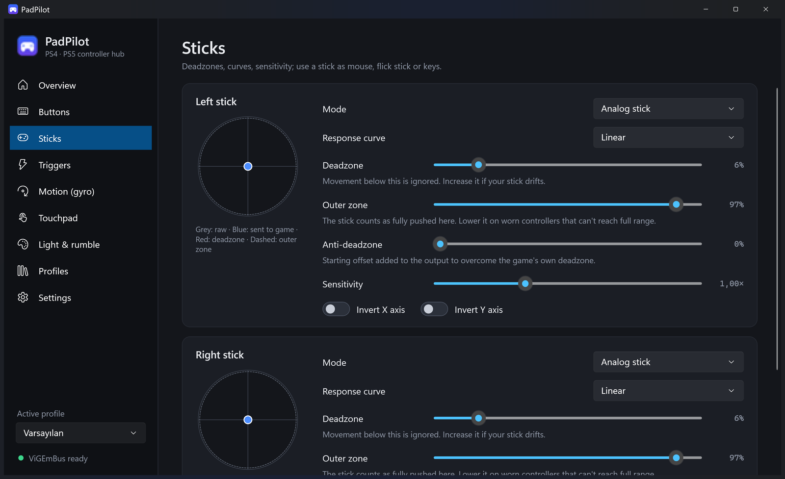
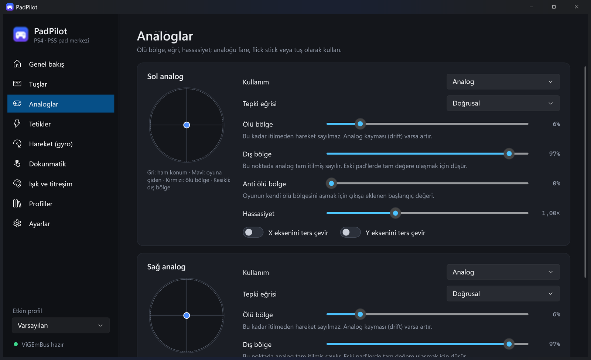
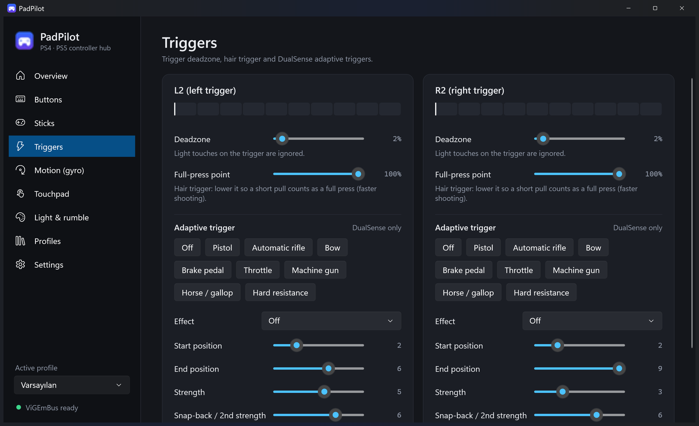

<p align="center"></p>

<h1 align="center">PadPilot</h1>

<p align="center">
PS4 (DualShock 4) ve PS5 (DualSense) kumandaları için Windows uygulaması · Windows app for PS4 &amp; PS5 controllers<br>
<a href="#türkçe">Türkçe</a> · <a href="#english">English</a>
</p>

<p align="center"></p>

---

## Türkçe



PadPilot; DS4Windows, DSX/DualSenseY ve Steam Input'un en sevilen özelliklerini tek, sade bir uygulamada toplar.
Pad'i bağlarsın, kendiliğinden tanınır ve oyunlarda Xbox 360 (veya DualShock 4) kumandası olarak çalışır.

### Özellikler
- **Otomatik tanıma** — USB ve Bluetooth, DualShock 4, DualSense ve DualSense Edge; pil, bağlantı ve Hz göstergesi
- **Oyunlara görünüm** — sanal Xbox 360 veya DualShock 4 (ViGEmBus); oyun titreşimi pad'e geri gelir
- **Çift girişi önleme** — HidHide ile gerçek pad oyunlardan gizlenir
- **Tuş eşleme** — her tuşa pad tuşu, klavye, fare veya eylem; uzun basışa ikinci görev; turbo
- **Analoglar** — ölü bölge, dış bölge, anti ölü bölge, 4 tepki eğrisi, canlı önizleme; analoğu fare, flick stick, WASD veya ok tuşu yapma
- **Tetikler** — saç tetik; DualSense adaptif tetikleri (8 efekt, 9 hazır ayar: tabanca, otomatik tüfek, yay, fren, gaz…)
- **Gyro** — fare veya sağ analog; tuşla etkinleştirme, otomatik kalibrasyon, titreme yumuşatma
- **Touchpad** — fare, dokun-tıkla, iki parmakla kaydırma, sağ yarı sağ tık
- **Işık** — sabit renk, pile göre, gökkuşağı; parlaklık; düşük pilde yanıp sönme; oyuncu LED'leri
- **Profiller** — oyun açılınca kendiliğinden değişen profiller
- **Güç** — PS + Options ile Bluetooth pad'i kapatma, boşta kapatma, düşük pil bildirimi
- Sistem tepsisi, Windows ile başlama, **Türkçe / İngilizce** arayüz

### Kurulum
1. [Releases](../../releases/latest) sayfasından `PadPilot-Setup-x.y.z.exe` dosyasını indir ve çalıştır.
2. Kurulum, eksikse **ViGEmBus** ve **HidHide** sürücülerini de kurar (yönetici onayı ister; HidHide sonrası yeniden başlatma gerekebilir).
3. Pad'i bağla. Bluetooth için: PS5'te Create + PS, PS4'te Share + PS tuşlarına ışık yanıp sönene kadar bas, sonra Windows Bluetooth ayarlarından ekle.

Gereksinim: Windows 10 (1809) veya Windows 11, 64 bit. .NET kurmana gerek yok.

> Kullanırken DS4Windows, DSX gibi diğer pad uygulamalarını kapat; aynı anda çalışırlarsa birbirlerini bozar.

### Kaynaktan derleme
```powershell
dotnet build src\PadPilot.App\PadPilot.App.csproj -c Release
dotnet test tests\PadPilot.Tests\PadPilot.Tests.csproj
powershell -ExecutionPolicy Bypass -File installer\build.ps1   # kurulum dosyası (Inno Setup 6 gerekir)
```

---

## English



PadPilot brings the best-loved features of DS4Windows, DSX/DualSenseY and Steam Input together in one clean app.
Connect your controller: it is detected automatically and shows up in games as an Xbox 360 (or DualShock 4) controller.

### Features
- **Automatic detection** — USB and Bluetooth, DualShock 4, DualSense and DualSense Edge; battery, connection and polling rate
- **Virtual controller** — Xbox 360 or DualShock 4 via ViGEmBus; game rumble is forwarded to the pad
- **No double input** — HidHide hides the physical controller from games
- **Button mapping** — map any button to a pad button, key, mouse button or action; long-press second action; turbo
- **Sticks** — deadzone, outer zone, anti-deadzone, 4 response curves, live preview; stick as mouse, flick stick, WASD or arrows
- **Triggers** — hair trigger; DualSense adaptive triggers (8 effects, 9 presets: pistol, automatic rifle, bow, brake, throttle…)
- **Gyro** — to mouse or right stick; button activation, automatic calibration, jitter smoothing
- **Touchpad** — mouse, tap to click, two-finger scroll, right-half right click
- **Lightbar** — solid color, by battery, rainbow; brightness; low-battery flash; player LEDs
- **Profiles** — switch automatically when a game starts
- **Power** — turn off a Bluetooth controller with PS + Options, idle turn-off, low-battery notifications
- System tray, start with Windows, **Turkish / English** UI

### Installation
1. Download `PadPilot-Setup-x.y.z.exe` from [Releases](../../releases/latest) and run it.
2. The installer also installs the **ViGEmBus** and **HidHide** drivers if they are missing (admin approval required; a restart may be needed after HidHide).
3. Connect your controller. For Bluetooth: hold Create + PS (PS5) or Share + PS (PS4) until the light blinks, then add it in Windows Bluetooth settings.

Requirements: Windows 10 (1809) or Windows 11, 64-bit. No separate .NET install needed.

> Close other controller apps such as DS4Windows or DSX while using PadPilot; running them together causes conflicts.

### Building from source
```powershell
dotnet build src\PadPilot.App\PadPilot.App.csproj -c Release
dotnet test tests\PadPilot.Tests\PadPilot.Tests.csproj
powershell -ExecutionPolicy Bypass -File installer\build.ps1   # installer (requires Inno Setup 6)
```

---

## License / Lisans
MIT — see [LICENSE](LICENSE). Bundled drivers and libraries: [THIRD-PARTY-NOTICES.md](THIRD-PARTY-NOTICES.md).

PadPilot is not affiliated with Sony Interactive Entertainment or Microsoft. PlayStation, DualShock and DualSense are trademarks of Sony Interactive Entertainment Inc.
PadPilot, Sony Interactive Entertainment veya Microsoft ile bağlantılı değildir.
